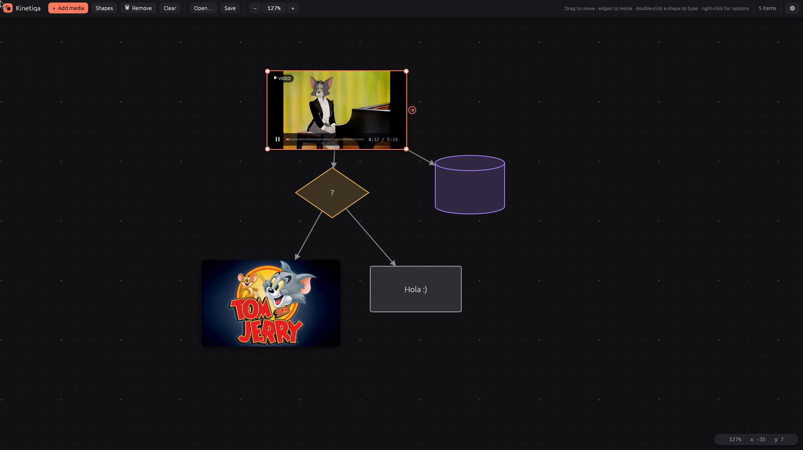

# Kinetiqa

**A desktop moodboard app, written in Rust.**



Drop images, animated GIFs and videos onto an infinite board, then pan, zoom, move and resize
them. Add shapes, connect them with arrows, and type inside them. Boards save to files and can be
reopened later.

## Features

- Videos play on the board through ffmpeg, with play/pause and seeking.
- Media loads on background threads, so the interface never freezes.
- Flowchart shapes and arrows, with text you can type inside them.

## Building

You need [Rust](https://rustup.rs) and ffmpeg installed.

```sh
cargo run --release
```
